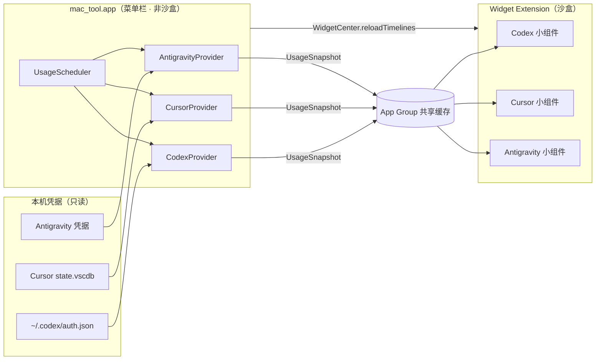

# mac_tool

> 一个轻量、常驻菜单栏的 macOS 小工具，通过桌面小组件实时监控 AI 编程工具的 Coding Plan 额度使用情况。


> [!NOTE]
> Codex、Cursor、Antigravity 三个服务的菜单栏监控、桌面小组件（圆环 / Codex 风格条形双样式）与阈值提醒均已可用，目前正在完善 Sparkle 2 自动更新与正式发布流水线。进度见 [路线图](#路线图)。

## 简介

日常同时使用 Codex、Antigravity（AGY）、Cursor 等多个 AI 编程工具时，各家的额度窗口、重置周期和计费方式都不同，需要分别打开网页或命令行查看。`mac_tool` 把这些信息集中到 macOS 桌面小组件和菜单栏上，一眼就能看到还剩多少额度、什么时候重置。

## 功能特性

- **菜单栏常驻**：无 Dock 图标，后台运行，资源占用很低
- **桌面小组件**：基于 WidgetKit，可直接放在 macOS 桌面或通知中心，均支持右键「编辑小组件」切换 **圆环样式** 或 **条形样式（Codex 风格）**
  - **Codex**：5 小时会话窗口剩余额度、周剩余额度与重置倒计时
  - **Antigravity**：按官方模型分组与 5 小时 / 周窗口展示剩余额度与重置时间，可在编辑界面自定义勾选展示的分桶
  - **Cursor**：当前账单周期总剩余额度、API 剩余额度与重置倒计时
- **免登录关联**：只读复用本机已有的登录状态，**不保存任何账号密码**
- **智能刷新**：默认每 5 分钟刷新一次（可选 1 / 5 / 15 / 30 分钟），睡眠和锁屏时暂停，唤醒后立即刷新，网络出错时按指数退避重试
- **阈值提醒**：用量达到设定阈值（默认 80% / 95%）时发送系统本地通知
- **应用内更新**：基于 [Sparkle](https://sparkle-project.org/)，每天自动检查新版本，也可以在菜单栏手动「检查更新…」，一键安装并重启，不用重新下载安装包
- **极少依赖**：除自动更新用的 Sparkle 外，只使用 Apple 系统框架

## 系统要求

| 项目 | 要求 |
| --- | --- |
| 操作系统 | macOS 14 Sonoma 或更高版本（桌面小组件从 Sonoma 开始支持） |
| 芯片 | Apple Silicon / Intel |
| 前置条件 | 已在本机登录过要监控的工具（Codex CLI、Antigravity、Cursor） |

## 安装

### Homebrew（计划中）

```bash
brew install --cask sadlll/tap/mac-tool
```

### 手动安装

1. 从 [Releases](https://github.com/sadlll/mac_tool/releases) 下载最新的 `.dmg`
2. 把 `mac_tool.app` 拖到「应用程序」文件夹
3. 首次打开时，如果系统提示“无法验证开发者”：

   ```bash
   xattr -dr com.apple.quarantine /Applications/mac_tool.app
   ```

> [!NOTE]
> 如果发布包还没有经过 Apple 公证（Notarization），只做了 ad-hoc 签名，就需要执行上面这一步。拿到 Developer ID 后会补上公证。

## 使用方法

1. 启动 `mac_tool`，菜单栏会出现图标
2. 点击图标 →「账户关联」，应用会自动检测本机各工具的登录状态
3. 在桌面上右键 →「编辑小组件」，搜索 `mac_tool`，添加需要的小组件
4. 在「设置」里调整刷新间隔、提醒阈值和开机自启

### 更新

- 应用默认每天自动检查一次更新，发现新版本时会弹窗询问是否安装
- 也可以随时点击菜单栏图标 →「检查更新…」手动检查
- 在「设置 → 更新」中可以开启“自动下载并安装”，或关闭自动检查
- 每个更新包都经过 EdDSA 签名，安装前会自动校验，防止被篡改
- 通过 Homebrew 安装的用户也可以直接用应用内更新，不必再执行 `brew upgrade`

## 数据来源与隐私

`mac_tool` 不提供独立的账号体系，而是**以只读方式**读取各工具已经存在本地的登录凭据，再用它请求对应服务的用量接口：

| 工具 | 本地凭据位置 | 说明 |
| --- | --- | --- |
| Codex | `~/.codex/auth.json` | 只读解析 Codex CLI 登录后生成的本地文件 |
| Cursor | `~/Library/Application Support/Cursor/User/globalStorage/state.vscdb` | 以 `SQLITE_OPEN_READONLY` 只读打开；新版加密 token 需通过 macOS 钥匙串 `"Cursor Safe Storage"` 在内存中解密（派生密钥进程内缓存，避免轮询重复弹窗） |
| Antigravity | `~/.gemini/antigravity/daemon/*.json` | 只读获取本机守护进程端口与 CSRF Token，仅请求本机回环地址，无需钥匙串弹窗 |

隐私承诺：

- 凭据**只在内存中使用**，不写入磁盘，也不上传到任何第三方服务器
- 网络请求只发往各工具的官方服务端，以及用于检查更新的 GitHub（不会附带任何用量或凭据信息）
- 小组件进程运行在沙盒中，只能读取主应用写入 App Group 共享容器的**用量缓存**，接触不到凭据
- 不收集任何遥测或统计数据

> [!IMPORTANT]
> 部分用量接口不是官方公开的 API，可能随时变化或失效。本项目和 OpenAI、Google、Anysphere 没有任何关联，请自行评估是否符合各服务的使用条款。

## 架构概览



- **主应用**：不开沙盒，负责读取凭据、定时拉取数据，并把结果写入共享容器
- **Widget Extension**：强制沙盒，只读取缓存来渲染，不发任何网络请求
- **自动更新**：由主应用内置的 Sparkle 负责，从 GitHub Releases 拉取已签名的 appcast 和安装包
- **MacToolCore**：本地 Swift Package，放 Provider 协议、数据模型和解析逻辑，可以单独做单元测试

## 从源码构建

### 依赖

- Xcode 16+
- [XcodeGen](https://github.com/yonaskolb/XcodeGen)：`brew install xcodegen`
- （可选）SwiftLint、SwiftFormat：`brew install swiftlint swiftformat`

### 构建步骤

```bash
git clone git@github.com:sadlll/mac_tool.git
cd mac_tool
xcodegen generate          # 根据 project.yml 生成 mac_tool.xcodeproj
open mac_tool.xcodeproj
```

测试、Lint 等开发命令以及目录结构见 [AGENTS.md](./AGENTS.md)。

## 文档

- [产品与技术规格（SPEC）](docs/SPEC.md)：数据模型、接口契约、状态流转、异常边界与验收标准
- [实施计划（PLAN）](docs/PLAN.md)：按任务拆解的进度清单与验证命令
- [架构决策记录（ADR）](docs/adr/)：关键技术选型与决策依据（`0001`–`0006`）
- [架构设计](docs/ARCHITECTURE.md)：进程边界、沙盒共享缓存、调度与低资源策略
- [Provider 接入说明](docs/PROVIDERS.md)：Codex / Cursor / Antigravity 的只读凭据读取与接口字段映射
- [本地开发指南](docs/DEVELOPMENT.md)：XcodeGen、`./Scripts/run.sh`、小组件调试与测试规范
- [发布与自动更新指南](docs/RELEASING.md)：Sparkle 2 密钥管理、签名公证与发布流程

## 路线图

- [x] 工程脚手架：XcodeGen、MacToolCore、CI
- [x] 菜单栏应用骨架与设置页
- [x] Codex Provider + 小组件（圆环 / 条形双样式）
- [x] Cursor Provider + 小组件（兼容新版 Safe Storage 加密凭据）
- [x] Antigravity Provider + 小组件（支持自定义展示模型分桶）
- [x] 阈值通知、睡眠/锁屏暂停与唤醒刷新、开机自启（`SMAppService`）
- [x] Sparkle 2 应用内更新（菜单栏手动检查、每日自动检查与 EdDSA 校验）
- [x] GitHub Releases 自动构建、EdDSA 签名与 `appcast.xml` 发布流水线（含 dry-run 演练）
- [ ] Homebrew Cask

## 同类项目

开源社区里已经有一些优秀的同类工具，如果你需要支持更多服务，可以看看：

- [steipete/CodexBar](https://github.com/steipete/CodexBar)：支持的服务非常多，带菜单栏和 WidgetKit 小组件
- [burakgon/ai-usage-menubar](https://github.com/burakgon/ai-usage-menubar)：支持 Codex、Cursor、Antigravity 等
- [loke-dev/codex-usage-menu](https://github.com/loke-dev/codex-usage-menu)：专注 Codex 用量

`mac_tool` 的定位是**只聚焦 Codex / Antigravity / Cursor、实现尽量精简、文档全中文**。

## 贡献

欢迎提交 Issue 和 Pull Request。代码规范、架构约束、测试和提交要求统一写在 [AGENTS.md](./AGENTS.md) 里，人类贡献者和 AI 编程助手都按它执行。

## 许可证

本项目基于 [MIT License](./LICENSE) 开源。
