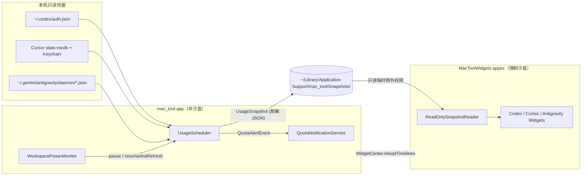

# 架构设计

本文档说明 `mac_tool` 的模块划分、进程边界、数据流与低资源调度策略。

## 总体模块划分

| 模块 | 路径 | 职责 |
| --- | --- | --- |
| 核心库 | `Packages/MacToolCore` | 纯 Swift 模型、Provider 协议与实现、只读凭据读取器、快照缓存、阈值判定、统一调度器 `UsageScheduler`；无 AppKit/SwiftUI 依赖，可独立 `swift test` |
| 主应用 | `App/` | 无 Dock 图标菜单栏应用（`LSUIElement = true`）、设置页、电源/锁屏监听 `WorkspacePowerMonitor`、本地通知 `QuotaNotificationService` |
| 桌面小组件 | `Widgets/` | 沙盒化 WidgetKit 扩展，包含 Codex / Antigravity / Cursor 三个独立小组件，支持圆环与 Codex 风格条形双样式切换 |

## 进程边界与权限

- **主应用（非沙盒）**：负责只读读取各工具本地凭据并拉取用量，随后将不含任何凭据的 `UsageSnapshot` JSON 原子写入共享快照目录，并调用 `WidgetCenter.shared.reloadTimelines(ofKind:)` 通知系统刷新小组件。
- **小组件扩展（强制沙盒）**：
  - `com.apple.security.app-sandbox = true`
  - **无网络权限**，禁止发起任何 HTTP 请求
  - **无凭据目录权限**，仅通过 `com.apple.security.temporary-exception.files.home-relative-path.read-only` 拥有 `/Library/Application Support/mac_tool/` 的只读权限
  - `TimelinePolicy` 固定为 `.never`，不依赖系统高频唤醒扩展

> [!NOTE]
> 为什么本地开发版暂未启用 `group.*` App Group？macOS 要求 `group.*` 形式的 App Group 配备付费 Apple Developer 账号的 Provisioning Profile；使用上述只读共享目录可以在保持小组件强制沙盒的同时，支持本地 ad-hoc 签名与 CI 零配置构建。

## 调度与低资源策略

1. **统一调度**：所有定时轮询均由 `UsageScheduler`（Swift `actor`）集中管理，禁止在视图或其他模块自建 `Timer`。
2. **故障隔离**：每次刷新按 `ProviderID.allCases` 顺序遍历，单个 Provider 失败不会影响其他 Provider 的数据更新与缓存写入。
3. **指数退避**：单个 Provider 连续失败时按 `RetryBackoffPolicy`（初始 30 秒，指数增长，上限 30 分钟）延迟下次自动重试；用户手动点击「立即刷新」会跳过退避立即重试。
4. **睡眠与锁屏暂停**：`WorkspacePowerMonitor` 监听 `NSWorkspace` 睡眠/唤醒/熄屏与系统锁屏/解锁通知，睡眠或锁屏时取消轮询任务，唤醒或解锁后立即刷新一次。
5. **零响应缓存**：所有网络请求均使用 `URLSessionConfiguration.ephemeral`，不写磁盘缓存和 Cookie。
6. **阈值提醒去重**：`ThresholdEvaluator` 在用量跨过预警（默认 80%）或紧急（默认 95%）阈值时触发一次本地通知，同级不重复推送，额度重置回落后自动复位。
