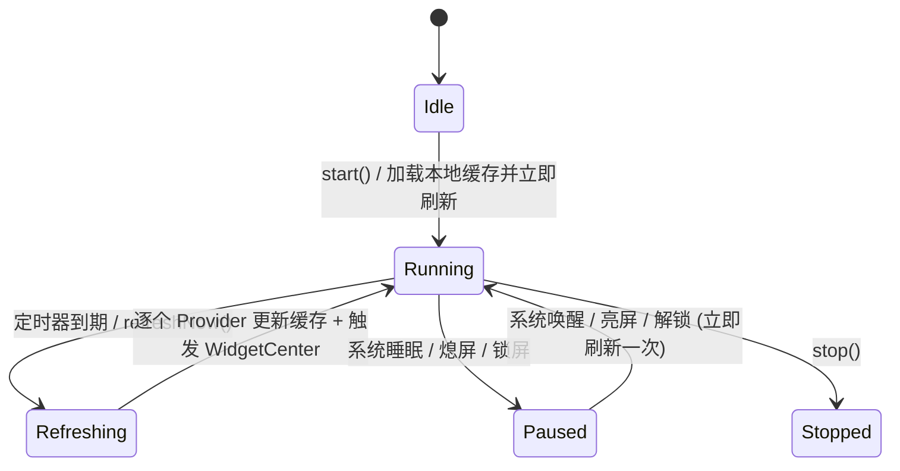

# mac_tool 产品与技术规格说明书（SPEC）

> 本文档是 `mac_tool` 的唯一需求与契约事实来源（Single Source of Truth）。架构选型原因见 `docs/adr/`，任务拆解见 [docs/PLAN.md](./PLAN.md)。

## 1. 目标与范围

### 1.1 目标
提供一个轻量、低资源占用的 macOS 菜单栏常驻应用与桌面小组件集合，实时监控用户在 **Codex、Antigravity（AGY）、Cursor** 三个 AI 编程工具上的 Coding Plan 额度使用情况。

### 1.2 非目标（Out of Scope）
- **不支持其他 AI 服务**（不接受新增第四个服务的 PR）
- **不自建账号系统或内嵌登录 WebView**，只读复用本机已有登录态
- **不做三合一总览小组件**，每家工具各自提供独立桌面小组件
- **不上架 Mac App Store**（主应用不开沙盒以便读取本机工具凭据）
- **不收集任何遥测、统计或崩溃上报数据**
- **不设 Beta 更新通道**，仅发布稳定版

### 1.3 运行环境
- 操作系统：macOS 14.0 Sonoma 及以上（桌面小组件、SwiftUI `MenuBarExtra`、Observation、`AppIntents`）
- 架构：Apple Silicon / Intel
- 语言：界面与文档全中文

---

## 2. 数据模型契约（`MacToolCore`）

所有跨进程共享模型均必须为 `Codable` + `Equatable` + `Sendable` 值类型，且**严禁包含任何凭据、邮箱、用户 ID 或原始响应头**。

### 2.1 `ProviderID`
```swift
public enum ProviderID: String, CaseIterable, Codable, Identifiable, Sendable {
    case codex        // 展示名："Codex"
    case antigravity  // 展示名："Antigravity"
    case cursor       // 展示名："Cursor"
}
```

### 2.2 `UsageSnapshot` / `QuotaWindow` / `ModelQuota`
| 类型 | 关键字段 | 约束 |
| --- | --- | --- |
| `QuotaWindow` | `id: String`, `label: String`, `usedPercentage: Double`, `resetAt: Date?`, `detail: String?` | `usedPercentage` 强制钳位在 `0...100`；`remainingPercentage = max(0, 100 - usedPercentage)` |
| `ModelQuota` | `id: String`, `modelName: String`, `remainingPercentage: Double`, `resetAt: Date?` | `remainingPercentage` 强制钳位在 `0...100`；`usedPercentage = max(0, 100 - remainingPercentage)` |
| `UsageSnapshot` | `provider: ProviderID`, `fetchedAt: Date`, `planName: String?`, `primaryWindow: QuotaWindow?`, `secondaryWindow: QuotaWindow?`, `modelQuotas: [ModelQuota]`, `billingSummary: String?` | 严格按 `provider` 隔离；`highestUsedPercentage` 取所有窗口与模型中的最大已用比例 |

### 2.3 `CredentialStatus` 与 `ProviderError`
- `CredentialStatus`：`.available(source: String)`（仅描述脱敏路径）、`.missing`、`.invalid(reason: String)`
- `ProviderError`：`.credentialMissing`、`.credentialInvalid(String)`、`.unauthorized`、`.networkFailure(String)`、`.invalidResponse(String)`、`.unsupportedFormat(String)`

### 2.4 共享缓存契约（`SnapshotStore` / `ReadOnlySnapshotReader`）
- 存储目录：`~/Library/Application Support/mac_tool/Snapshots/<provider>.json`（ISO-8601 日期、排序键、原子写入）
- 主应用可读写；沙盒化 Widget Extension 通过只读临时例外权限只读该目录，禁止访问其他任何本机路径

---

## 3. Provider 接口契约

```swift
public protocol UsageProvider: Sendable {
    var id: ProviderID { get }
    func detectCredential() async -> CredentialStatus
    func fetchUsage() async throws -> UsageSnapshot
}
```

| Provider | 只读凭据来源 | 请求端点（均为非官方接口） | 核心字段映射 |
| --- | --- | --- | --- |
| **Codex** | `~/.codex/auth.json`（`tokens.access_token`、`tokens.account_id`） | `GET https://chatgpt.com/backend-api/wham/usage` | `plan_type` → `planName`；`rate_limit.primary_window` → `session_5h`；`rate_limit.secondary_window` → `weekly` |
| **Cursor** | `~/Library/Application Support/Cursor/User/globalStorage/state.vscdb`（`SQLITE_OPEN_READONLY`）+ 钥匙串 `"Cursor Safe Storage"`（新版 `cursor-safe-storage:v1:`） | `POST https://api2.cursor.sh/aiserver.v1.DashboardService/GetCurrentPeriodUsage` | `planUsage.totalPercentUsed` → `monthly_total`；`planUsage.apiPercentUsed` → `monthly_api`；`billingCycleEnd` → `resetAt`；`includedSpend / limit` → `billingSummary` |
| **Antigravity** | `~/.gemini/antigravity/daemon/*.json`（`httpPort`、`csrfToken`） | 主：`POST http://127.0.0.1:<port>/exa.language_server_pb.LanguageServerService/RetrieveUserQuotaSummary`<br>辅/回退：`GetUserStatus` | `response.groups[].buckets[]` → `modelQuotas`（`bucketId`、`<组名> · 周/5h`、`remainingFraction * 100`、`resetTime`）；`planInfo.planName` → `planName` |

网络约束：
- 仅允许访问上述官方/本机回环地址及自动更新用的 `github.com`、`objects.githubusercontent.com`
- 一律使用 `URLSessionConfiguration.ephemeral`（禁用磁盘缓存与 Cookie 持久化）

---

## 4. 状态流转

### 4.1 调度器状态机（`UsageScheduler`）


- 默认轮询间隔：5 分钟（可选 1 / 5 / 15 / 30 分钟）
- 单 Provider 连续失败 `n` 次后进入指数退避：`min(30 * 2^(n-1), 1800)` 秒（上限 30 分钟）；手动「立即刷新」忽略退避立即重试

### 4.2 阈值提醒状态机（`ThresholdEvaluator`）
- 预警阈值默认 `80%`，紧急阈值默认 `95%`（可在设置页调整或关闭）
- 状态迁移：`none → warning`（触发预警通知）、`warning → critical`（触发紧急通知）、`none → critical`（触发紧急通知）；同级不重复推送；当最高使用率回落至 `< warningPercentage` 时自动复位为 `none`

---

## 5. 异常边界与安全红线

| 异常场景 | 预期行为 |
| --- | --- |
| 凭据文件/数据库缺失 | `detectCredential()` 返回 `.missing`，界面显示“未检测到凭据”，不发起网络请求、不报错崩溃 |
| HTTP 401 / 403 | 返回 `ProviderError.unauthorized`，提示用户在原工具重新登录，进入指数退避 |
| 非官方接口 JSON 结构变化 | 返回 `ProviderError.unsupportedFormat`，保留上次成功快照或显示拉取失败，禁止崩溃或展示错误数值 |
| 单个 Provider 超时或失败 | 仅该 Provider 记录失败与退避，不影响其他 Provider 刷新与缓存写入 |
| Cursor 新版加密 token 轮询 | 派生出的 16 字节 AES 密钥仅缓存在进程内存中，同一进程生命周期内最多读取一次钥匙串 |
| Antigravity 存在已退出进程的旧 daemon JSON | 按修改时间倒序依次尝试，自动跳过连接失败的旧文件并命中活跃守护进程 |
| 系统无网络 / 睡眠锁屏 | 睡眠或锁屏暂停轮询；无网络时按指数退避，禁止紧密循环重试 |

---

## 6. 桌面小组件规格

- **三个独立小组件**：`CodexQuotaWidget`、`CursorQuotaWidget`、`AntigravityQuotaWidget`，均支持 `systemSmall` 与 `systemMedium`
- **统一展示剩余百分比**，并在右键 →「编辑小组件」支持切换两种样式：
  - **圆环样式（默认）**：圆环进度圈 + 居中大号百分比 + 窗口标签 + 重置倒计时
  - **条形样式（Codex 风格）**：大号 `XX% 剩余` + 粗圆角胶囊进度条 + 左右双栏（Medium）/ 紧凑双行（Small）
- **Antigravity 专属配置**：支持在「编辑小组件」中多选要展示的模型分桶；长模型组名自动缩写并将 `5h` / `周` 拆为独立胶囊标签，避免截断

---

## 7. 验收标准（Acceptance Criteria）

1. **安全与隐私**：
   - 全仓静态审查确认所有凭据文件与 SQLite 均为只读访问（`SQLITE_OPEN_READONLY`），无任何写入/修改/删除逻辑
   - `Snapshots/*.json` 与日志中不包含任何 token、邮箱、用户 ID
   - `MacToolWidgets.appex` 签名权限满足 `app-sandbox = true` 且无网络权限
2. **资源占用**：
   - 空闲态 CPU 接近 `0%`（`ps -o %cpu` 验证），Release 包常驻内存 `< 50 MB`
   - 睡眠/锁屏暂停轮询，唤醒后自动刷新
3. **功能闭环**：
   - 菜单栏启动即自动拉取 Codex、Cursor、Antigravity 实时数据，支持手动「立即刷新」、设置刷新间隔、阈值通知与开机自启
   - 桌面小组件库可搜到 `mac_tool` 三个小组件，添加后展示准确且可切换圆环/条形样式，Antigravity 可自定义模型分桶
4. **自动化质量门禁**：
   - `swiftformat --lint .` 0 违规
   - `swiftlint --strict` 0 违规
   - `swift test --package-path Packages/MacToolCore` 全部通过（Mock + 脱敏 Fixture，不访问真实网络与钥匙串）
   - `xcodegen generate && xcodebuild ... build` 通过
5. **自动更新与发布（待完成）**：
   - 集成 Sparkle 2，支持每日自动检查与菜单栏「检查更新…」
   - CI 自动构建、EdDSA 签名并生成 `appcast.xml` 上传至 GitHub Releases
